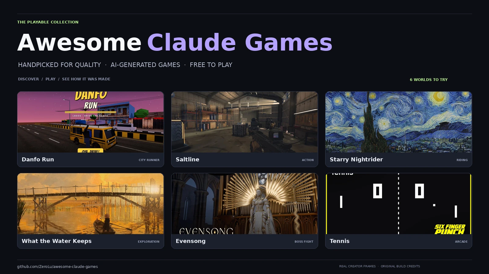

# Awesome Claude Games

> **Claude AI games you can play right now.**

Handpicked browser games, local builds, and demos made with Claude. Each entry tells you why it is worth trying and credits the creator.

**119 browser games**, plus 2 local builds and 3 interactive demos.

[PlayForge](https://playforge-arcade.xiongying95.chatgpt.site/) · [Full directory](CATALOG.md) · [Submit a game](CONTRIBUTING.md) · [Cover credits](assets/cover-credits.md)

## Editor’s Pick

X counts are dated snapshots of creator posts, not game plays.

<table>
  <tr>
    <td align="left" valign="top" width="33%">
       <a href="https://danforun.com/"><strong>Danfo Run</strong></a>
      
Make your stops in Lagos traffic while motorcycles weave past and the bus radio plays local music.

      
<a href="https://danforun.com/">Play</a> · <a href="https://x.com/eureka_seamless/status/2103938108668420286">14,362,076 X views</a>

      

Attribution &amp; sources

        
The creator credits Claude for development in Three.js; GPT contributed art.

        
<a href="https://x.com/eureka_seamless/status/2103938108668420286">Creator source</a> · <a href="https://technext24.com/reviews/lagos-run-danfo-game-review-nigeria/">Creator interview</a>

      

    </td>
    <td align="left" valign="top" width="33%">
       <a href="https://claude.ai/artifact/BGY1SztrAYcJQHSsnHHGmp"><strong>Saltline</strong></a>
      
Cutting relays gives your run through the storm-battered port a purpose beyond staying alive under robot guard.

      
<a href="https://claude.ai/artifact/BGY1SztrAYcJQHSsnHHGmp">Play</a> · <a href="https://x.com/felixrieseberg/status/2119925633564463609">4,465,009 X views</a>

      

Attribution &amp; sources

        
Fable 5.2; the author describes a single-prompt experiment.

        
<a href="https://x.com/felixrieseberg/status/2119925633564463609">Creator source</a>

      

    </td>
    <td align="left" valign="top" width="33%">
       <a href="https://tesana.com/game/sky-reach"><strong>Sky Reach</strong></a>
      
Harpoon giant walkers by the legs, then fly straight into an orbital dogfight.

      
<a href="https://tesana.com/game/sky-reach">Play</a> · <a href="https://x.com/Rubzem/status/2105425742100341240">1,998,236 X views</a>

      

Attribution &amp; sources

        
The creator credits Claude Opus 5.5 via Tesana and Three.js.

        
<a href="https://x.com/Rubzem/status/2105425742100341240">Creator source</a>

      

    </td>
  </tr>
</table>

## Action & adventure

<table>
  <tr>
    <td align="left" valign="top" width="50%">
      <a href="https://www.anchorterminal.com/games/agent-of-somebody/"><strong>Agent of Somebody</strong></a>
      
Skip the buildup and go straight to boss fights where picking a path through the barrage is half the battle.

      
<a href="https://www.anchorterminal.com/games/agent-of-somebody/">Play</a>

      

Attribution &amp; sources

        
Fable 5.2.

        
<a href="https://www.reddit.com/r/accelerate/comments/1xtjrsp/fable_52_built_me_a_game_overnight_a_bit_of_back/">Creator source</a>

      

    </td>
    <td align="left" valign="top" width="50%">
       <a href="https://aidens-revenge.pages.dev/"><strong>Aiden&#x27;s Revenge</strong></a>
      
Grab a couch co-op partner and see how a kid&#x27;s own game sketches translate into a pixel-art brawl.

      
<a href="https://aidens-revenge.pages.dev/">Play</a>

      

Attribution &amp; sources

        
Fable 5.2 for code; OpenAI Images and ElevenLabs for assets.

        
<a href="https://notesbylex.com/fable-5-2-one-shotted-my-nephews-dream-game">Creator source</a>

      

    </td>
  </tr>
  <tr>
    <td align="left" valign="top" width="50%">
       <a href="https://soupsarah.itch.io/alias"><strong>ALIAS: In Space No-One Can Hear You Meow</strong></a>
      
Sneaking through space is a more amusing proposition when the operative you&#x27;re trying to keep out of sight is a cat.

      
<a href="https://soupsarah.itch.io/alias">Play</a>

      

Attribution &amp; sources

        
The creator credits Claude for programming, with Gemini and Copilot also involved.

        
<a href="https://itch.io/jam/jamference-ai-game-jam-hack-1/rate/5091917">Creator source</a>

      

    </td>
    <td align="left" valign="top" width="50%">
       <a href="https://woflo.itch.io/all-you-mean-to-me"><strong>all you mean to me</strong></a>
      
Play as the one thing a forbidding museum is least equipped to contain: a wet brushstroke on the loose.

      
<a href="https://woflo.itch.io/all-you-mean-to-me">Play</a>

      

Attribution &amp; sources

        
Claude Opus 5.5 implemented most gameplay code, shaders, geometry and tests.

        
<a href="https://itch.io/jam/jamference-ai-game-jam-hack-3/rate/5289399">Creator source</a>

      

    </td>
  </tr>
  <tr>
    <td align="left" valign="top" width="50%">
       <a href="https://atlas-house.itch.io/bayun"><strong>Bayun</strong></a>
      
Climb toward a storytelling cat from folklore, with riddles to untangle on the way up.

      
<a href="https://atlas-house.itch.io/bayun">Play</a>

      

Attribution &amp; sources

        
Claude Opus 5.5 wrote the Godot game and contributed character and art pipelines.

        
<a href="https://itch.io/jam/jamference-ai-game-jam-hack-1/rate/5089657">Creator source</a>

      

    </td>
    <td align="left" valign="top" width="50%">
       <a href="https://blameless.petruha.ge/"><strong>BLAMELESS</strong></a>
      
If you&#x27;ve ever been paged for an incident, there&#x27;s a particular joke in sorting one out as a 3D shooter.

      
<a href="https://blameless.petruha.ge/">Play</a>

      

Attribution &amp; sources

        
Fable 5.2; original prompt in the project repository.

        
<a href="https://github.com/Petyok/blameless">Creator source</a>

      

    </td>
  </tr>
  <tr>
    <td align="left" valign="top" width="50%">
      <a href="https://brontide.live/"><strong>Brontide</strong></a>
      
The payoff for exploring the underground hangar is getting behind the controls of its sixty-ton mech.

      
<a href="https://brontide.live/">Play</a>

      

Attribution &amp; sources

        
The creator documents the Claude-assisted build.

        
<a href="https://www.reddit.com/r/ClaudeAI/comments/1xvl8nu/">Creator source</a>

      

    </td>
    <td align="left" valign="top" width="50%">
       <a href="https://omw-game.kimaki.dev"><strong>Castle Valley</strong></a>
      
Step inside a moving oil painting: follow a torchlit trail from purple mountains to a village below the castle.

      
<a href="https://omw-game.kimaki.dev">Play</a> · <a href="https://x.com/__morse/status/2122013410309153042">231,304 X views</a>

      

Attribution &amp; sources

        
Tommy D. Rossi credits Claude Fable 5.2 for the playable adaptation of Desimulate’s original “omw” pixel-art scene.

        
<a href="https://x.com/__morse/status/2122013410309153042">Creator source</a> · <a href="https://github.com/remorses/castle-valley">Project repository</a>

      

    </td>
  </tr>
  <tr>
    <td align="left" valign="top" width="50%">
       <a href="https://mistercoconut.itch.io/cindervale"><strong>Cindervale</strong></a>
      
Try a metroidvania that makes getting around as demanding as fighting, with a grapple for the caves and curtains of bullets to dodge.

      
<a href="https://mistercoconut.itch.io/cindervale">Play</a>

      

Attribution &amp; sources

        
The creator attributes the build to Claude Code with human assistance.

        
<a href="https://mistercoconut.itch.io/cindervale">Creator source</a>

      

    </td>
    <td align="left" valign="top" width="50%">
       <a href="https://evensong-phi.vercel.app/"><strong>Evensong</strong></a>
      
If the boss fight is what you come to a soulslike for, this compact dark-fantasy encounter gets right to it.

      
<a href="https://evensong-phi.vercel.app/">Play</a> · <a href="https://x.com/kevin_t_ngo/status/2120238844754923874">487,066 X views</a>

      

Attribution &amp; sources

        
The creator credits Claude Fable for the build.

        
<a href="https://x.com/kevin_t_ngo/status/2120238844754923874">Creator source</a>

      

    </td>
  </tr>
  <tr>
    <td align="left" valign="top" width="50%">
       <a href="https://feed-backrooms.vercel.app"><strong>Feed the Backrooms</strong></a>
      
Find out what the Backrooms feel like from the other side of the chase, as the monster rather than the escapee.

      
<a href="https://feed-backrooms.vercel.app">Play</a> · <a href="https://x.com/LexnLin/status/2119966127149429093">Creator post on X</a>

      

Attribution &amp; sources

        
The creator credits Claude Fable for the build.

        
<a href="https://x.com/LexnLin/status/2119966127149429093">Creator source</a>

      

    </td>
    <td align="left" valign="top" width="50%">
       <a href="https://gilt-and-gutter.vercel.app/"><strong>Gilt &amp; Gutter</strong></a>
      
Pick between two duelists and face your opponent at eye level instead of watching the fight from the sidelines.

      
<a href="https://gilt-and-gutter.vercel.app/">Play</a> · <a href="https://x.com/kevin_t_ngo/status/2119900487688622171">108,488 X views</a>

      

Attribution &amp; sources

        
The creator credits Claude Fable for the build.

        
<a href="https://x.com/kevin_t_ngo/status/2119900487688622171">Creator source</a>

      

    </td>
  </tr>
  <tr>
    <td align="left" valign="top" width="50%">
       <a href="https://storytellermeeka.itch.io/greatest-work-of-art"><strong>Greatest Work of Art</strong></a>
      
Let the images do the unnerving in a short horror story that never puts a word on screen.

      
<a href="https://storytellermeeka.itch.io/greatest-work-of-art">Play</a>

      

Attribution &amp; sources

        
Claude implemented the game, including its audio engine and headless playtest.

        
<a href="https://storytellermeeka.itch.io/greatest-work-of-art">Creator source</a>

      

    </td>
    <td align="left" valign="top" width="50%">
       <a href="https://shubhu121.github.io/hitdude/play/"><strong>Hitofude</strong></a>
      
The brush-painted look is the draw, especially once you notice the game achieves it without sprite assets.

      
<a href="https://shubhu121.github.io/hitdude/play/">Play</a> · <a href="https://x.com/positronx_/status/2120374208043876422">Creator post on X</a>

      

Attribution &amp; sources

        
The creator credits Claude Fable for the build.

        
<a href="https://x.com/positronx_/status/2120374208043876422">Creator source</a>

      

    </td>
  </tr>
  <tr>
    <td align="left" valign="top" width="50%">
       <a href="https://clipmarz.itch.io/hungereth"><strong>HUNGERETH</strong></a>
      
Keeping your torch alive gives you something to worry about besides the monsters coming at you from every side.

      
<a href="https://clipmarz.itch.io/hungereth">Play</a>

      

Attribution &amp; sources

        
The creator credits Claude for programming, design and audio mixing.

        
<a href="https://clipmarz.itch.io/hungereth">Creator source</a>

      

    </td>
    <td align="left" valign="top" width="50%">
       <a href="https://app.usecrayon.ai/play/0cd7624e-1297-417e-a5be-b3c3036a496a"><strong>Kumokiri</strong></a>
      
Step into a painterly 3D samurai world if you&#x27;re curious how brushwork can read in motion rather than in a still image.

      
<a href="https://app.usecrayon.ai/play/0cd7624e-1297-417e-a5be-b3c3036a496a">Play</a> · <a href="https://x.com/aniketjart/status/2121101334900617631">3,432 X views</a>

      

Attribution &amp; sources

        
The creator credits Claude Fable for the build.

        
<a href="https://x.com/aniketjart/status/2121101334900617631">Creator source</a>

      

    </td>
  </tr>
  <tr>
    <td align="left" valign="top" width="50%">
       <a href="https://loktar00.github.io/lanternfall/"><strong>Lanternfall</strong></a>
      
Try it for the mood: the 3D fantasy world is as much a reason to keep moving as the fights along the way.

      
<a href="https://loktar00.github.io/lanternfall/">Play</a> · <a href="https://x.com/loktar00/status/2120192761542615271">201,883 X views</a>

      

Attribution &amp; sources

        
The creator credits Claude Fable for the build.

        
<a href="https://x.com/loktar00/status/2120192761542615271">Creator source</a>

      

    </td>
    <td align="left" valign="top" width="50%">
       <a href="https://8hm-v2.itch.io/last-light"><strong>Last Light</strong></a>
      
Zombies are only half the problem; the other half is deciding what to upgrade and when to get behind the wheel.

      
<a href="https://8hm-v2.itch.io/last-light">Play</a>

      

Attribution &amp; sources

        
The developer says the game was made with Claude Sonnet 5.5.

        
<a href="https://8hm-v2.itch.io/last-light">Creator source</a>

      

    </td>
  </tr>
  <tr>
    <td align="left" valign="top" width="50%">
       <a href="https://luminazombies.com/"><strong>Lumina Zombies</strong></a>
      
Get your bearings in the first-person zombie map, then see what Easter eggs you can find without becoming lunch.

      
<a href="https://luminazombies.com/">Play</a> · <a href="https://x.com/LuminaBench/status/2120660076927099048">Creator post on X</a>

      

Attribution &amp; sources

        
The creator credits Claude Fable for the build.

        
<a href="https://x.com/LuminaBench/status/2120660076927099048">Creator source</a>

      

    </td>
    <td align="left" valign="top" width="50%">
       <a href="https://op7418.github.io/guizang-game-skill/"><strong>Mist-Locked Gate / 雾锁山门</strong></a>
      
Open the Chinese-language demo to see what a reusable game-making skill looks like as a playable project, not just a prompt.

      
<a href="https://op7418.github.io/guizang-game-skill/">Play</a>

      

Attribution &amp; sources

        
See the creator&#x27;s workflow.

        
<a href="https://github.com/op7418/guizang-game-skill/blob/main/README.en.md">Creator source</a>

      

    </td>
  </tr>
  <tr>
    <td align="left" valign="top" width="50%">
       <a href="https://nipad.itch.io/number"><strong>Number</strong></a>
      
The challenge is keeping a running count while the game is asking you to act, not simply recognizing a number.

      
<a href="https://nipad.itch.io/number">Play</a>

      

Attribution &amp; sources

        
The developer credits Fable, Opus, and Sonnet in Claude Code with gameplay logic, levels, UI, and tools.

        
<a href="https://nipad.itch.io/number">Creator source</a>

      

    </td>
    <td align="left" valign="top" width="50%">
       <a href="https://nyxalium.itch.io/out-of-frame"><strong>Out of Frame</strong></a>
      
Step through the frames of three famous paintings and get to know their compositions by putting them back in order.

      
<a href="https://nyxalium.itch.io/out-of-frame">Play</a>

      

Attribution &amp; sources

        
Claude Opus 5.5 implemented the three painting worlds, physics, gallery and effects.

        
<a href="https://itch.io/jam/jamference-ai-game-jam-hack-3/rate/5294483">Creator source</a>

      

    </td>
  </tr>
  <tr>
    <td align="left" valign="top" width="50%">
       <a href="https://appsbymeredith.itch.io/paper-moon"><strong>Paper Moon</strong></a>
      
Roll a little paper character through the night and see how much 3D atmosphere can fit inside a single file.

      
<a href="https://appsbymeredith.itch.io/paper-moon">Play</a>

      

Attribution &amp; sources

        
The creator names Claude Opus 5.5 and Three.js r170 as its build tools.

        
<a href="https://appsbymeredith.itch.io/paper-moon">Creator source</a>

      

    </td>
    <td align="left" valign="top" width="50%">
       <a href="https://simonw.github.io/raccoon-heist/"><strong>Raccoon Heist</strong></a>
      
Plan your way past the guards with a crew better known for raiding bins than pulling off heists.

      
<a href="https://simonw.github.io/raccoon-heist/">Play</a>

      

Attribution &amp; sources

        
The creator documents the Claude-assisted build.

        
<a href="https://simonwillison.net/2026/Aug/5/raccoon-heist/">Creator source</a>

      

    </td>
  </tr>
  <tr>
    <td align="left" valign="top" width="50%">
       <a href="https://claude.ai/artifact/BGY1SztrAYcJQHSsnHHGmp"><strong>Saltline</strong></a>
      
Cutting relays gives your run through the storm-battered port a purpose beyond staying alive under robot guard.

      
<a href="https://claude.ai/artifact/BGY1SztrAYcJQHSsnHHGmp">Play</a> · <a href="https://x.com/felixrieseberg/status/2119925633564463609">4,465,009 X views</a>

      

Attribution &amp; sources

        
Fable 5.2; the author describes a single-prompt experiment.

        
<a href="https://x.com/felixrieseberg/status/2119925633564463609">Creator source</a>

      

    </td>
    <td align="left" valign="top" width="50%">
       <a href="https://save-the-world-fable.vercel.app/"><strong>Save the World</strong></a>
      
Take in the details of a city street from ground level while playing through a first-person action prototype.

      
<a href="https://save-the-world-fable.vercel.app/">Play</a> · <a href="https://x.com/global_techgirl/status/2120246750459961453">Creator post on X</a>

      

Attribution &amp; sources

        
The creator credits Claude Fable for the build.

        
<a href="https://x.com/global_techgirl/status/2120246750459961453">Creator source</a>

      

    </td>
  </tr>
  <tr>
    <td align="left" valign="top" width="50%">
       <a href="https://bannerfall.itch.io/siege-wing"><strong>Siege Wing</strong></a>
      
Bring a modern attack helicopter to a medieval fight and see what a cannon, rockets, and missiles do to the odds.

      
<a href="https://bannerfall.itch.io/siege-wing">Play</a> · <a href="https://x.com/builderjaydub/status/2120223731520040966">Creator post on X</a>

      

Attribution &amp; sources

        
The creator credits Claude Fable for the build.

        
<a href="https://x.com/builderjaydub/status/2120223731520040966">Creator source</a>

      

    </td>
    <td align="left" valign="top" width="50%">
       <a href="https://cocolitocollective.itch.io/sky-patent"><strong>Sky Patent</strong></a>
      
Your aircraft design isn&#x27;t just for show: take it through three shoot-&#x27;em-up missions to earn new parts for the next build.

      
<a href="https://cocolitocollective.itch.io/sky-patent">Play</a>

      

Attribution &amp; sources

        
Claude Opus 5.5 implemented the JavaScript, procedural graphics and sound.

        
<a href="https://itch.io/jam/jamference-ai-game-jam-hack-2/rate/5196780">Creator source</a>

      

    </td>
  </tr>
  <tr>
    <td align="left" valign="top" width="50%">
       <a href="https://tesana.com/game/sky-reach"><strong>Sky Reach</strong></a>
      
Harpoon giant walkers by the legs, then fly straight into an orbital dogfight.

      
<a href="https://tesana.com/game/sky-reach">Play</a> · <a href="https://x.com/Rubzem/status/2105425742100341240">1,998,236 X views</a>

      

Attribution &amp; sources

        
The creator credits Claude Opus 5.5 via Tesana and Three.js.

        
<a href="https://x.com/Rubzem/status/2105425742100341240">Creator source</a>

      

    </td>
    <td align="left" valign="top" width="50%">
       <a href="https://app.usecrayon.ai/play/992c2130-43da-416b-a577-aed9514d3057"><strong>Skywake</strong></a>
      
Take a flying craft out on a series of quests when you want somewhere to go rather than a lap timer to beat.

      
<a href="https://app.usecrayon.ai/play/992c2130-43da-416b-a577-aed9514d3057">Play</a> · <a href="https://x.com/aniketjart/status/2120378493729222700">Creator post on X</a>

      

Attribution &amp; sources

        
The creator credits Claude Fable for the build.

        
<a href="https://x.com/aniketjart/status/2120378493729222700">Creator source</a>

      

    </td>
  </tr>
  <tr>
    <td align="left" valign="top" width="50%">
       <a href="https://ans106.itch.io/exa"><strong>Spears of Exekias</strong></a>
      
Duel Achilles inside the visual world of an ancient vase painting, with no dialogue to break the illusion.

      
<a href="https://ans106.itch.io/exa">Play</a>

      

Attribution &amp; sources

        
Claude Code and Codex helped create the code and procedural artwork.

        
<a href="https://itch.io/jam/jamference-ai-game-jam-hack-3/rate/5291223">Creator source</a>

      

    </td>
    <td align="left" valign="top" width="50%">
       <a href="https://wquguru.github.io/fable52-fps-repro/demos/04-fps/"><strong>SUBLEVEL 07</strong></a>
      
Try a three-wave FPS in a flooded substation, then inspect how one HTML file draws and scores the whole encounter.

      
<a href="https://wquguru.github.io/fable52-fps-repro/demos/04-fps/">Play</a> · <a href="https://x.com/wquguru/status/2120383332722905400">37,342 X views</a>

      

Attribution &amp; sources

        
The creator documents using Claude Code with Fable 5.2 to produce the single-file FPS and its procedural models, textures, and audio.

        
<a href="https://x.com/wquguru/status/2120383332722905400">Creator source</a> · <a href="https://github.com/wquguru/fable52-fps-repro">Project repository</a>

      

    </td>
  </tr>
  <tr>
    <td align="left" valign="top" width="50%">
       <a href="https://sunwarden.higgsfield.app/"><strong>Sunwarden</strong></a>
      
Explore and solve your way across a 3D world before putting down the puzzles to face the boss.

      
<a href="https://sunwarden.higgsfield.app/">Play</a>

      

Attribution &amp; sources

        
Fable 5.2 with Higgsfield tools.

        
<a href="https://higgsfield.ai/mcp/new-skill-2fb09e61-56a6-45de-9eef-7028a5bafbab">Creator source</a>

      

    </td>
    <td align="left" valign="top" width="50%">
       <a href="https://rivergame-kappa.vercel.app"><strong>The Waking River</strong></a>
      
Take your time exploring the fantasy landscape, then consider that the browser adventure was built without a game engine.

      
<a href="https://rivergame-kappa.vercel.app">Play</a> · <a href="https://x.com/flxrnc/status/2120494277528580110">5,478 X views</a>

      

Attribution &amp; sources

        
The creator credits Claude Fable for the build.

        
<a href="https://x.com/flxrnc/status/2120494277528580110">Creator source</a>

      

    </td>
  </tr>
  <tr>
    <td align="left" valign="top" width="50%">
      <a href="https://mrdoob.github.io/three-quake/"><strong>Three.js Quake</strong></a>
      
See how the original Quake shareware plays in a browser, then look through the open port code.

      
<a href="https://mrdoob.github.io/three-quake/">Play</a>

      

Attribution &amp; sources

        
The project credits mrdoob and Claude for the Three.js port, not the original game or its assets.

        
<a href="https://github.com/mrdoob/three-quake#credits">Creator source</a> · <a href="https://github.com/mrdoob/three-quake">Project repository</a>

      

    </td>
    <td align="left" valign="top" width="50%">
       <a href="https://ngong2000.itch.io/tunas-last-archive"><strong>TUNAS: Last Archive</strong></a>
      
Lead a squad with something worth bringing home: lost knowledge for the last archive you have to defend.

      
<a href="https://ngong2000.itch.io/tunas-last-archive">Play</a>

      

Attribution &amp; sources

        
The developer selected the Claude Code build and then refined it with Claude Code, Codex, and human input.

        
<a href="https://ngong2000.itch.io/tunas-last-archive">Creator source</a>

      

    </td>
  </tr>
  <tr>
    <td align="left" valign="top" width="50%">
       <a href="https://wavedash.com/games/understory"><strong>Understory</strong></a>
      
Plant light to make bridges and traps, then outthink five guardians to bring the seasons back.

      
<a href="https://wavedash.com/games/understory">Play</a> · <a href="https://x.com/DannyLimanseta/status/2107505970809336071">27,145 X views</a>

      

Attribution &amp; sources

        
The creator credits Claude Sonnet 5.5.

        
<a href="https://x.com/DannyLimanseta/status/2107505970809336071">Creator source</a>

      

    </td>
    <td align="left" valign="top" width="50%">
       <a href="https://valle-morta.vercel.app/"><strong>Valle Morta</strong></a>
      
Trade the usual industrial shooter backdrop for a firefight set in a detailed Italian village.

      
<a href="https://valle-morta.vercel.app/">Play</a> · <a href="https://x.com/LexnLin/status/2121934071429468543">Creator post on X</a>

      

Attribution &amp; sources

        
The creator credits Claude Fable for the build.

        
<a href="https://x.com/LexnLin/status/2121934071429468543">Creator source</a>

      

    </td>
  </tr>
  <tr>
    <td align="left" valign="top" width="50%">
       <a href="https://redrakam.itch.io/wake-word-almost-home"><strong>Wake Word: Almost Home</strong></a>
      
Try a psychological horror game that makes an ordinary trip home feel less reassuring the closer you get.

      
<a href="https://redrakam.itch.io/wake-word-almost-home">Play</a>

      

Attribution &amp; sources

        
Claude Code plus ChatGPT review.

        
<a href="https://www.reddit.com/r/aigamedev/comments/1xbwv2h/i_built_a_horror_game_with_claude_code_chatgpt/">Creator source</a>

      

    </td>
    <td align="left" valign="top" width="50%">
       <a href="https://hallucinatedgames.itch.io/wick"><strong>WICK</strong></a>
      
A candle-cat that burns through its own wax makes the next torch feel like a finish line.

      
<a href="https://hallucinatedgames.itch.io/wick">Play</a>

      

Attribution &amp; sources

        
The creator says Claude Code with Claude Opus wrote, tested, and deployed the code, levels, art, and tools.

        
<a href="https://hallucinatedgames.itch.io/wick">Creator source</a>

      

    </td>
  </tr>
  <tr>
    <td align="left" valign="top" width="50%">
       <a href="https://korusagi.itch.io/wind-up-cat"><strong>Wind-up cat</strong></a>
      
Break into the Vacuum Factory as a pocket-sized wind-up robot with a clear job: get the caged cats out.

      
<a href="https://korusagi.itch.io/wind-up-cat">Play</a>

      

Attribution &amp; sources

        
The creator built the game with Claude Opus 5.5.

        
<a href="https://itch.io/jam/jamference-ai-game-jam-hack-1/rate/5096791">Creator source</a>

      

    </td>
    <td align="left" valign="top" width="50%">
      <a href="https://wontfix-game.netlify.app/"><strong>WONTFIX</strong></a>
      
If a project-management board already makes you uneasy, step into a horror story that takes that feeling literally.

      
<a href="https://wontfix-game.netlify.app/">Play</a>

      

Attribution &amp; sources

        
Claude credited by the creator; the repository notes ElevenLabs audio.

        
<a href="https://github.com/emollick/audiologs">Creator source</a>

      

    </td>
  </tr>
</table>

## Arcade, racing & sports

<table>
  <tr>
    <td align="left" valign="top" width="50%">
       <a href="https://38-0-0.com/"><strong>38-0-0</strong></a>
      
Try to draft a Premier League XI that can win all 38 matches with no draws or losses.

      
<a href="https://38-0-0.com/">Play</a>

      

Attribution &amp; sources

        
Creator Deniz Sancar told MobileGamer.biz he used Claude Code to make the original web game and then its app.

        
<a href="https://mobilegamer.biz/the-uks-number-one-ios-game-38-0-0-was-built-overnight-by-an-amateur-using-claude-code/">Creator source</a>

      

    </td>
    <td align="left" valign="top" width="50%">
       <a href="https://4096x.itch.io/4096-torch"><strong>4096 Torch</strong></a>
      
Turn matching ghosts into fuel for your torch while steering clear of the numbers too big to take on.

      
<a href="https://4096x.itch.io/4096-torch">Play</a>

      

Attribution &amp; sources

        
Claude designed, balanced and programmed the game.

        
<a href="https://4096x.itch.io/4096-torch">Creator source</a>

      

    </td>
  </tr>
  <tr>
    <td align="left" valign="top" width="50%">
       <a href="https://capybara-vibejam26.leocoout.dev/"><strong>A Game About Capybaras Delivering Food</strong></a>
      
The tower of groceries wobbles as you drift through town, so going faster can cost you the delivery.

      
<a href="https://capybara-vibejam26.leocoout.dev/">Play</a>

      

Attribution &amp; sources

        
Leo credits Claude Code with Opus 4.7 for code, with other tools credited for asset generation.

        
<a href="https://www.reddit.com/r/ClaudeAI/comments/1urzr1q/i_just_made_25k_usd_with_my_capybara_game_built/">Creator source</a>

      

    </td>
    <td align="left" valign="top" width="50%">
       <a href="https://remix.gg/g/banana-mine-rush"><strong>Banana Mine Rush</strong></a>
      
Race karts through a 3D mine with friends or go after a place on the leaderboard yourself.

      
<a href="https://remix.gg/g/banana-mine-rush">Play</a> · <a href="https://x.com/0xChuckstock/status/2120125184606658728">10,259 X views</a>

      

Attribution &amp; sources

        
The creator credits Claude Fable for the build.

        
<a href="https://x.com/0xChuckstock/status/2120125184606658728">Creator source</a>

      

    </td>
  </tr>
  <tr>
    <td align="left" valign="top" width="50%">
      <a href="https://vinish.dev/crust-courier"><strong>Crust Courier</strong></a>
      
Put the pizza on a motorbike and see what happens when a delivery shift becomes a time trial.

      
<a href="https://vinish.dev/crust-courier">Play</a>

      

Attribution &amp; sources

        
The creator documents the Claude-assisted build.

        
<a href="https://www.reddit.com/r/ClaudeGameDev/comments/1xu808o/37_browser_games_and_25_simulators_all_made_with/">Creator source</a>

      

    </td>
    <td align="left" valign="top" width="50%">
       <a href="https://danforun.com/"><strong>Danfo Run</strong></a>
      
Make your stops in Lagos traffic while motorcycles weave past and the bus radio plays local music.

      
<a href="https://danforun.com/">Play</a> · <a href="https://x.com/eureka_seamless/status/2103938108668420286">14,362,076 X views</a>

      

Attribution &amp; sources

        
The creator credits Claude for development in Three.js; GPT contributed art.

        
<a href="https://x.com/eureka_seamless/status/2103938108668420286">Creator source</a> · <a href="https://technext24.com/reviews/lagos-run-danfo-game-review-nigeria/">Creator interview</a>

      

    </td>
  </tr>
  <tr>
    <td align="left" valign="top" width="50%">
      <a href="https://vinish.dev/dorbaaz-kite-fighting-browser-based-game"><strong>Dorbaaz</strong></a>
      
Use your kite string as both leash and blade as you cross and cut rivals above the city rooftops.

      
<a href="https://vinish.dev/dorbaaz-kite-fighting-browser-based-game">Play</a>

      

Attribution &amp; sources

        
The creator documents the Claude-assisted build.

        
<a href="https://www.reddit.com/r/ClaudeGameDev/comments/1xu808o/37_browser_games_and_25_simulators_all_made_with/">Creator source</a>

      

    </td>
    <td align="left" valign="top" width="50%">
       <a href="https://fallline-9zo.pages.dev"><strong>Fall Line</strong></a>
      
Take on a downhill run tuned against the creator&#x27;s experience of riding a real mountain bike.

      
<a href="https://fallline-9zo.pages.dev">Play</a> · <a href="https://x.com/BananaOfMercy/status/2123037856398733438">12,090 X views</a>

      

Attribution &amp; sources

        
The creator credits Claude Fable for the build.

        
<a href="https://x.com/BananaOfMercy/status/2123037856398733438">Creator source</a>

      

    </td>
  </tr>
  <tr>
    <td align="left" valign="top" width="50%">
       <a href="https://jupitax.itch.io/ink-and-tide"><strong>Ink &amp; Tide</strong></a>
      
Every word is a shot in this pirate roguelite, so your typing is what keeps the cannons firing.

      
<a href="https://jupitax.itch.io/ink-and-tide">Play</a>

      

Attribution &amp; sources

        
The creator says the game was built entirely with Claude.

        
<a href="https://jupitax.itch.io/ink-and-tide">Creator source</a>

      

    </td>
    <td align="left" valign="top" width="50%">
       <a href="https://thedannos.itch.io/lightkeeper"><strong>Lightkeeper</strong></a>
      
Read the stormy water from the shore and use your lighthouse beam to steer ships clear of the rocks.

      
<a href="https://thedannos.itch.io/lightkeeper">Play</a>

      

Attribution &amp; sources

        
Claude Code generated the visuals, software and tooling.

        
<a href="https://itch.io/jam/ai-jam-5/rate/5265063">Creator source</a>

      

    </td>
  </tr>
  <tr>
    <td align="left" valign="top" width="50%">
       <a href="https://vinish.dev/penguin-path-game-online"><strong>Penguin Path</strong></a>
      
Pick a route across the ice one hop at a time while watching for Arctic hazards.

      
<a href="https://vinish.dev/penguin-path-game-online">Play</a>

      

Attribution &amp; sources

        
The creator documents the Claude-assisted build.

        
<a href="https://www.reddit.com/r/ClaudeGameDev/comments/1xu808o/37_browser_games_and_25_simulators_all_made_with/">Creator source</a>

      

    </td>
    <td align="left" valign="top" width="50%">
       <a href="https://penguinsmack.pages.dev/"><strong>Penguin Smack</strong></a>
      
Take a quick detour into 3D arcade silliness if you miss the old Yetisports style of minigame.

      
<a href="https://penguinsmack.pages.dev/">Play</a>

      

Attribution &amp; sources

        
Claude Code / Opus 5.5 for gameplay; Codex for images.

        
<a href="https://www.reddit.com/r/ClaudeGameDev/comments/1x56n07/i_built_a_3d_yetisportsstyle_game_in_3_hours_with/">Creator source</a>

      

    </td>
  </tr>
  <tr>
    <td align="left" valign="top" width="50%">
       <a href="https://kestrelww.itch.io/pumpkin-panic"><strong>Pumpkin Panic</strong></a>
      
See how many treats you can catch in sixty seconds without letting a skull into the cauldron.

      
<a href="https://kestrelww.itch.io/pumpkin-panic">Play</a>

      

Attribution &amp; sources

        
Claude Code helped make the game and the scripts that draw its art.

        
<a href="https://kestrelww.itch.io/pumpkin-panic/devlog/1728592/how-pumpkin-panic-was-made-with-claude-in-one-afternoon-aigamejam">Creator source</a>

      

    </td>
    <td align="left" valign="top" width="50%">
      <a href="https://riftrungame.com/"><strong>Rift Run</strong></a>
      
Give your reflexes both jobs at once: dodge what the scroll sends your way and shoot what you can&#x27;t fly around.

      
<a href="https://riftrungame.com/">Play</a>

      

Attribution &amp; sources

        
The creator documents the Claude-assisted build.

        
<a href="https://www.reddit.com/r/ClaudeGameDev/comments/1xygvvo/">Creator source</a>

      

    </td>
  </tr>
  <tr>
    <td align="left" valign="top" width="50%">
       <a href="https://wavedash.com/games/rooftop-rally"><strong>Rooftop Rally</strong></a>
      
Play a pickleball match above the city streets instead of on the usual ground-level court.

      
<a href="https://wavedash.com/games/rooftop-rally">Play</a> · <a href="https://x.com/chongdashu/status/2120154573356793883">Creator post on X</a>

      

Attribution &amp; sources

        
The creator credits Claude Fable for the build.

        
<a href="https://x.com/chongdashu/status/2120154573356793883">Creator source</a>

      

    </td>
    <td align="left" valign="top" width="50%">
       <a href="https://granthaffner.itch.io/scratch"><strong>SCRATCH</strong></a>
      
The pleasure is in the reveal: scratch away the image of a house until the scene hidden underneath comes into view.

      
<a href="https://granthaffner.itch.io/scratch">Play</a>

      

Attribution &amp; sources

        
The jam submission identifies Claude Code as the primary coding tool.

        
<a href="https://itch.io/jam/jamference-ai-game-jam-hack-1/rate/5095813">Creator source</a>

      

    </td>
  </tr>
  <tr>
    <td align="left" valign="top" width="50%">
      <a href="https://skulljam.com/"><strong>Skull Jam</strong></a>
      
Try the physics duel solo first, then bring a second player to see what changes when another person is making the same calculations.

      
<a href="https://skulljam.com/">Play</a>

      

Attribution &amp; sources

        
Fable 5.2.

        
<a href="https://www.reddit.com/r/ClaudeAI/comments/1xuvop2/i_built_skull_jam_a_free_12_player_browser_game/">Creator source</a>

      

    </td>
    <td align="left" valign="top" width="50%">
       <a href="https://samg-coder.github.io/solstice-racing/"><strong>Solstice Racing</strong></a>
      
Plug in a controller if you like and race a jet-powered craft instead of another set of wheels.

      
<a href="https://samg-coder.github.io/solstice-racing/">Play</a> · <a href="https://x.com/SamGCoder/status/2120044542087070066">Creator post on X</a>

      

Attribution &amp; sources

        
The creator credits Claude Fable for the build.

        
<a href="https://x.com/SamGCoder/status/2120044542087070066">Creator source</a>

      

    </td>
  </tr>
  <tr>
    <td align="left" valign="top" width="50%">
       <a href="https://starrynightrider.com"><strong>Starry Nightrider</strong></a>
      
See what Van Gogh&#x27;s swirling night sky feels like from the saddle of a bike instead of from across a gallery.

      
<a href="https://starrynightrider.com">Play</a> · <a href="https://x.com/ebbyamir/status/2120284261089673376">1,980,333 X views</a>

      

Attribution &amp; sources

        
The creator credits Claude Fable for the build.

        
<a href="https://x.com/ebbyamir/status/2120284261089673376">Creator source</a>

      

    </td>
    <td align="left" valign="top" width="50%">
       <a href="https://tennis.sixfingerpunch.com/"><strong>Tennis</strong></a>
      
It starts as Pong and turns into a psychedelic paddle duel, best tried with the sound on.

      
<a href="https://tennis.sixfingerpunch.com/">Play</a> · <a href="https://x.com/photonstorm/status/2120330010112434313">415,215 X views</a>

      

Attribution &amp; sources

        
The creator credits Claude Fable 5.2 for the WebGL2 build.

        
<a href="https://x.com/photonstorm/status/2120330010112434313">Creator source</a>

      

    </td>
  </tr>
  <tr>
    <td align="left" valign="top" width="50%">
       <a href="https://loktar00.github.io/llm-test-pages/fable52-dino-chase/"><strong>Thunder Valley</strong></a>
      
Try it for the panic of a dinosaur chase in full 3D, especially if you like seeing how far an engine-free experiment can go.

      
<a href="https://loktar00.github.io/llm-test-pages/fable52-dino-chase/">Play</a> · <a href="https://x.com/loktar00/status/2120905457380507991">Creator post on X</a>

      

Attribution &amp; sources

        
The creator credits Claude Fable for the build.

        
<a href="https://x.com/loktar00/status/2120905457380507991">Creator source</a>

      

    </td>
    <td align="left" valign="top" width="50%">
       <a href="https://ringburst.itch.io/turfrush"><strong>Turfrush</strong></a>
      
Play if you like territory games where one daring loop can claim a chunk of the map or leave your trail open to a cut.

      
<a href="https://ringburst.itch.io/turfrush">Play</a>

      

Attribution &amp; sources

        
The creator says Claude wrote the game in a 48-hour experiment; graphics and audio are procedural.

        
<a href="https://ringburst.itch.io/turfrush">Creator source</a>

      

    </td>
  </tr>
  <tr>
    <td align="left" valign="top" width="50%">
      <a href="https://typissimo.com/"><strong>Typissimo</strong></a>
      
Try a round if you like rhythm games: accurate typing adds notes and drums, so the soundtrack changes as you play.

      
<a href="https://typissimo.com/">Play</a>

      

Attribution &amp; sources

        
The creator documents the Claude-assisted build.

        
<a href="https://www.reddit.com/r/ClaudeAI/comments/1xun1vk/">Creator source</a>

      

    </td>
    <td align="left" valign="top" width="50%">
       <a href="https://viktorkav.com.br/apoio/uno-com-escada/fable/"><strong>Uno com Escada</strong></a>
      
Play for the absurd sight of a little Fiat hauling a roof ladder around a forest racetrack.

      
<a href="https://viktorkav.com.br/apoio/uno-com-escada/fable/">Play</a> · <a href="https://x.com/ViktorKav/status/2122647483281015155">Creator post on X</a>

      

Attribution &amp; sources

        
The creator credits Claude Fable for the build.

        
<a href="https://x.com/ViktorKav/status/2122647483281015155">Creator source</a>

      

    </td>
  </tr>
  <tr>
    <td align="left" valign="top" width="50%">
       <a href="https://heat.pplx.app/"><strong>VICE ’86</strong></a>
      
Take a midnight drive through rain-slick streets in a neon city rendered from code.

      
<a href="https://heat.pplx.app/">Play</a> · <a href="https://x.com/AravSrinivas/status/2122338465648103676">84,089 X views</a>

      

Attribution &amp; sources

        
Perplexity credits its Teammate running Claude Fable 5.2.

        
<a href="https://x.com/AravSrinivas/status/2122338465648103676">Creator source</a>

      

    </td>
    <td></td>
  </tr>
</table>

## Puzzle & narrative

<table>
  <tr>
    <td align="left" valign="top" width="50%">
       <a href="https://aelysium.itch.io/art-cat-burglar"><strong>Art Cat Burglar</strong></a>
      
Pick this for a stealth game with an unusually charming setting: a museum full of cat paintings.

      
<a href="https://aelysium.itch.io/art-cat-burglar">Play</a>

      

Attribution &amp; sources

        
Claude Code implemented and tested the stealth systems, 3D renderer and editor.

        
<a href="https://itch.io/jam/jamference-ai-game-jam-hack-3/rate/5307807">Creator source</a>

      

    </td>
    <td align="left" valign="top" width="50%">
       <a href="https://hergal.itch.io/castling-rights"><strong>Castling Rights</strong></a>
      
Try it if you enjoy chess puzzles that build a whole challenge around one easily overlooked rule.

      
<a href="https://hergal.itch.io/castling-rights">Play</a>

      

Attribution &amp; sources

        
The creator credits Claude Code with the code, SVG art, procedural sound, and 15 of 20 levels.

        
<a href="https://hergal.itch.io/castling-rights">Creator source</a>

      

    </td>
  </tr>
  <tr>
    <td align="left" valign="top" width="50%">
       <a href="https://nebitula.itch.io/coalheart"><strong>Coalheart</strong></a>
      
Play for a puzzle where fire is scarce and getting a small creature through a temple means making that supply last.

      
<a href="https://nebitula.itch.io/coalheart">Play</a>

      

Attribution &amp; sources

        
Claude Code wrote the game and generated pixel art and synthesized audio in code.

        
<a href="https://itch.io/jam/ai-jam-5/rate/5213715">Creator source</a>

      

    </td>
    <td align="left" valign="top" width="50%">
       <a href="https://nicklesimba.itch.io/crosstographer"><strong>Crosstographer</strong></a>
      
Pick this if you like both exploration and wordplay: the crossword is hidden in the layout of a starship.

      
<a href="https://nicklesimba.itch.io/crosstographer">Play</a>

      

Attribution &amp; sources

        
The studio says Claude Code programmed the game; gameplay design, writing, art, and music were not AI-made.

        
<a href="https://nicklesimba.itch.io/crosstographer">Creator source</a>

      

    </td>
  </tr>
  <tr>
    <td align="left" valign="top" width="50%">
       <a href="https://kengoworks.itch.io/dawnlings"><strong>Dawnlings</strong></a>
      
Try it for the tactile challenge of tilting a 3D valley and rolling its tiny inhabitants to safety.

      
<a href="https://kengoworks.itch.io/dawnlings">Play</a> · <a href="https://x.com/kevin_t_ngo/status/2122969346935017497">20,617 X views</a>

      

Attribution &amp; sources

        
The creator credits Claude Fable for the build.

        
<a href="https://x.com/kevin_t_ngo/status/2122969346935017497">Creator source</a>

      

    </td>
    <td align="left" valign="top" width="50%">
      <a href="https://geosports.app/play"><strong>GeoSports</strong></a>
      
A five-clue daily round turns sports trivia into a map challenge you can finish in about a minute.

      
<a href="https://geosports.app/play">Play</a>

      

Attribution &amp; sources

        
Frank Michael Smith says he built and iterated on the first playable version with Claude Code.

        
<a href="https://fmsnewsletter.beehiiv.com/p/geosports">Creator source</a>

      

    </td>
  </tr>
  <tr>
    <td align="left" valign="top" width="50%">
       <a href="https://tesana.com/game/getting-there"><strong>Getting There</strong></a>
      
Travel with Moss by canoe and hot-air balloon through fourteen chapters without a timer or fail state.

      
<a href="https://tesana.com/game/getting-there">Play</a> · <a href="https://x.com/Rubzem/status/2122013352755126431">154,864 X views</a>

      

Attribution &amp; sources

        
The creator credits Claude Fable 5.2 via Tesana.

        
<a href="https://x.com/Rubzem/status/2122013352755126431">Creator source</a>

      

    </td>
    <td align="left" valign="top" width="50%">
       <a href="https://kawalight-studio.itch.io/grandmas-tech-support"><strong>Grandma&#x27;s Tech Support</strong></a>
      
Choose this when you want a short puzzle session with the comedy of taking questionable tech instructions from Grandma.

      
<a href="https://kawalight-studio.itch.io/grandmas-tech-support">Play</a>

      

Attribution &amp; sources

        
Kawalight Studio discloses Claude Code in its development notes.

        
<a href="https://kawalight-studio.itch.io/grandmas-tech-support">Creator source</a>

      

    </td>
  </tr>
  <tr>
    <td align="left" valign="top" width="50%">
       <a href="https://i-would-have-gotten-away-with-it.netlify.app/"><strong>I Would Have Gotten Away With It</strong></a>
      
Pick it for the role reversal: instead of unmasking the villain, you get to scare off the investigators.

      
<a href="https://i-would-have-gotten-away-with-it.netlify.app/">Play</a> · <a href="https://x.com/emollick/status/2119876449494540554">34,130 X views</a>

      

Attribution &amp; sources

        
The creator credits Claude Fable for the build.

        
<a href="https://x.com/emollick/status/2119876449494540554">Creator source</a>

      

    </td>
    <td align="left" valign="top" width="50%">
       <a href="https://cocolitocollective.itch.io/laser-dot"><strong>Laser Dot</strong></a>
      
Try it for an indirect-control puzzle where you point a laser and let a cat decide how to follow it.

      
<a href="https://cocolitocollective.itch.io/laser-dot">Play</a>

      

Attribution &amp; sources

        
Two Claude sessions implemented the project in 26 creator-approved batches.

        
<a href="https://itch.io/jam/jamference-ai-game-jam-hack-1/rate/5100771">Creator source</a>

      

    </td>
  </tr>
  <tr>
    <td align="left" valign="top" width="50%">
       <a href="https://funkyape.itch.io/meowcha"><strong>MEOWCHA</strong></a>
      
Play on a keyboard for the unlikely pairing of a cat-piloted mech and a puzzle platformer.

      
<a href="https://funkyape.itch.io/meowcha">Play</a>

      

Attribution &amp; sources

        
Claude Code for code, levels and pixel art; human direction and testing.

        
<a href="https://funkyape.itch.io/meowcha">Creator source</a>

      

    </td>
    <td align="left" valign="top" width="50%">
       <a href="https://sykoramade.itch.io/mule"><strong>MULE</strong></a>
      
Try it if you want match-three decisions to carry consequences beyond the score, from crafting supplies to surviving a fight.

      
<a href="https://sykoramade.itch.io/mule">Play</a>

      

Attribution &amp; sources

        
The creator credits Claude Code for the build and Claude for the music.

        
<a href="https://sykoramade.itch.io/mule">Creator source</a>

      

    </td>
  </tr>
  <tr>
    <td align="left" valign="top" width="50%">
       <a href="https://strangeboltz.itch.io/patchwork60"><strong>PatchWork60</strong></a>
      
Play for a visual puzzle that turns recognizing pieces of a painting into a one-minute sprint.

      
<a href="https://strangeboltz.itch.io/patchwork60">Play</a>

      

Attribution &amp; sources

        
Claude Code created the software, procedural art and sound.

        
<a href="https://strangeboltz.itch.io/patchwork60">Creator source</a>

      

    </td>
    <td align="left" valign="top" width="50%">
       <a href="https://linostar.itch.io/sillykitty"><strong>Silly Kitty</strong></a>
      
Choose this for the gentle comedy of steering a robot that has to coax, rather than control, a distractible cat.

      
<a href="https://linostar.itch.io/sillykitty">Play</a>

      

Attribution &amp; sources

        
The creator says Claude built the whole game under human direction.

        
<a href="https://itch.io/jam/jamference-ai-game-jam-hack-1/rate/5093895">Creator source</a>

      

    </td>
  </tr>
  <tr>
    <td align="left" valign="top" width="50%">
       <a href="https://quantumwhisker.itch.io/snip"><strong>SNIP</strong></a>
      
Try it if you enjoyed cutting paper snowflakes: every fold changes where a single snip will appear in the finished pattern.

      
<a href="https://quantumwhisker.itch.io/snip">Play</a>

      

Attribution &amp; sources

        
Claude Code wrote the Godot game, and Claude generated solvable level designs.

        
<a href="https://itch.io/jam/jamference-ai-game-jam-hack-2/rate/5213093">Creator source</a>

      

    </td>
    <td align="left" valign="top" width="50%">
       <a href="https://markeljan.itch.io/tally-light"><strong>TALLY LIGHT</strong></a>
      
Play if you want the challenge of making a good cut in real time instead of directly controlling the on-screen action.

      
<a href="https://markeljan.itch.io/tally-light">Play</a>

      

Attribution &amp; sources

        
Markeljan describes using Claude Code to build and test the game.

        
<a href="https://markeljan.itch.io/tally-light">Creator source</a>

      

    </td>
  </tr>
  <tr>
    <td align="left" valign="top" width="50%">
      <a href="https://johnnyffm.github.io/tumblebuds/"><strong>Tumblebuds: The Journey Home</strong></a>
      
Pick this for a 3D puzzle adventure where the goal is to shepherd little creatures rather than defeat them.

      
<a href="https://johnnyffm.github.io/tumblebuds/">Play</a>

      

Attribution &amp; sources

        
Fable 5.2 in Claude Code.

        
<a href="https://www.reddit.com/r/ClaudeAI/comments/1xx4y79/i_built_a_3d_puzzle_game_for_my_5yearold_with/">Creator source</a> · <a href="https://github.com/JohnnyFFM/tumblebuds">Project repository</a>

      

    </td>
    <td></td>
  </tr>
</table>

## RPG & strategy

<table>
  <tr>
    <td align="left" valign="top" width="50%">
       <a href="https://coyne-studios.itch.io/ares-outpost"><strong>ARES OUTPOST</strong></a>
      
There are no fixed lanes: experiment with layouts and upgrades instead of just filling predetermined tower slots.

      
<a href="https://coyne-studios.itch.io/ares-outpost">Play</a>

      

Attribution &amp; sources

        
The creator says they built the Godot project using Claude models via Cursor.

        
<a href="https://www.reddit.com/r/ClaudeAI/comments/1vc2aw2/1000_in_claude_credits_to_create_my_dream_game/">Creator source</a>

      

    </td>
    <td align="left" valign="top" width="50%">
       <a href="https://dexnazar.itch.io/argon-dominates"><strong>ARGON DOMINATES</strong></a>
      
Try it for the unusual pleasure of steering a cloud that grows by absorbing other noble gases.

      
<a href="https://dexnazar.itch.io/argon-dominates">Play</a>

      

Attribution &amp; sources

        
The creator credits Claude Code for the simulation, renderer, shaders, audio, levels, UI, and tools.

        
<a href="https://dexnazar.itch.io/argon-dominates">Creator source</a>

      

    </td>
  </tr>
  <tr>
    <td align="left" valign="top" width="50%">
      <a href="https://play.arrr.fun/"><strong>ARRR</strong></a>
      
Plot a course between procedural islands and see what happens when other pirates find the same waters.

      
<a href="https://play.arrr.fun/">Play</a>

      

Attribution &amp; sources

        
Jaeyun Noh credits Claude Code and Fable for world generation, multiplayer, and most gameplay systems.

        
<a href="https://www.reddit.com/r/ClaudeAI/comments/1usno3r/i_made_a_pirate_mmo_with_fable_and_the_entire/">Creator source</a>

      

    </td>
    <td align="left" valign="top" width="50%">
       <a href="https://simonw.github.io/battledrones/"><strong>Battle Drones</strong></a>
      
Pick this when you want tactical decisions in a real-time strategy match without installing anything.

      
<a href="https://simonw.github.io/battledrones/">Play</a>

      

Attribution &amp; sources

        
Opus 5.5 on the main build; Fable 5 in early versions.

        
<a href="https://simonwillison.net/2026/Oct/20/battledrones/">Creator source</a> · <a href="https://github.com/simonw/battledrones">Project repository</a>

      

    </td>
  </tr>
  <tr>
    <td align="left" valign="top" width="50%">
       <a href="https://pogorskii.itch.io/cerebronline"><strong>Cerebronline</strong></a>
      
Try it if you are curious what a browser RPG made for an Epic game jam looks like beyond a short tech demo.

      
<a href="https://pogorskii.itch.io/cerebronline">Play</a>

      

Attribution &amp; sources

        
The creator credits Claude Code and OpenAI Codex with most gameplay code and tooling.

        
<a href="https://pogorskii.itch.io/cerebronline">Creator source</a>

      

    </td>
    <td align="left" valign="top" width="50%">
       <a href="https://assetsmithy.itch.io/clanbound"><strong>Clanbound</strong></a>
      
Choose this if you like deckbuilders where where you place a creature matters as much as which card you draw.

      
<a href="https://assetsmithy.itch.io/clanbound">Play</a>

      

Attribution &amp; sources

        
Claude Code for game code; other tools used for assets.

        
<a href="https://www.reddit.com/r/aigamedev/comments/1wlcv9z/i_cant_code_a_deckbuilder_claude_code_and_my_own/">Creator source</a>

      

    </td>
  </tr>
  <tr>
    <td align="left" valign="top" width="50%">
       <a href="https://sunsetmesagames.itch.io/conga-crawl"><strong>Conga Crawl</strong></a>
      
Try it for a dungeon crawl where steering the entire marching line is the challenge.

      
<a href="https://sunsetmesagames.itch.io/conga-crawl">Play</a>

      

Attribution &amp; sources

        
Claude Code / Opus 5.5, with separately credited third-party assets.

        
<a href="https://www.reddit.com/r/ClaudeGameDev/comments/1xxembh/i_shipped_my_first_claude_code_game_to_itchio/">Creator source</a>

      

    </td>
    <td align="left" valign="top" width="50%">
      <a href="https://darkpattern.diamonddoge.org/"><strong>Dark Pattern</strong></a>
      
Play if you enjoy chasing a clever poker-like combo and then building around it with loot and a deep progression tree.

      
<a href="https://darkpattern.diamonddoge.org/">Play</a>

      

Attribution &amp; sources

        
The creator documents the Claude-assisted build.

        
<a href="https://www.reddit.com/r/ClaudeAI/comments/1xwzel1/">Creator source</a>

      

    </td>
  </tr>
  <tr>
    <td align="left" valign="top" width="50%">
       <a href="https://dread-and-district.netlify.app"><strong>Dread &amp; District</strong></a>
      
Pick this if the part of fantasy games you enjoy most is keeping an operation moving through dangerous territory.

      
<a href="https://dread-and-district.netlify.app">Play</a> · <a href="https://x.com/emollick/status/2120248525254742318">30,692 X views</a>

      

Attribution &amp; sources

        
The creator credits Claude Fable for the build.

        
<a href="https://x.com/emollick/status/2120248525254742318">Creator source</a>

      

    </td>
    <td align="left" valign="top" width="50%">
       <a href="https://gyeongseok.itch.io/lucky-castle"><strong>Lucky Castle</strong></a>
      
Try it for a castle defense game that asks you to turn a lucky number and uncertain dice into a plan.

      
<a href="https://gyeongseok.itch.io/lucky-castle">Play</a>

      

Attribution &amp; sources

        
The creator used Claude Code as the coding assistant during the jam and Codex for review.

        
<a href="https://gyeongseok.itch.io/lucky-castle">Creator source</a>

      

    </td>
  </tr>
  <tr>
    <td align="left" valign="top" width="50%">
       <a href="https://kawalight-studio.itch.io/othello-variants"><strong>Othello Variants</strong></a>
      
Play if you know classic Othello and want to see how seven variations change familiar board positions.

      
<a href="https://kawalight-studio.itch.io/othello-variants">Play</a>

      

Attribution &amp; sources

        
Parallel Claude Code agents designed and implemented the game.

        
<a href="https://kawalight-studio.itch.io/othello-variants">Creator source</a>

      

    </td>
    <td align="left" valign="top" width="50%">
       <a href="https://placebound.dariuszparys.com/"><strong>Placebound</strong></a>
      
Bring a second player if you want a desktop strategy game where planning breaks into real-time clashes.

      
<a href="https://placebound.dariuszparys.com/">Play</a>

      

Attribution &amp; sources

        
See the author&#x27;s account of developing the browser build with Claude.

        
<a href="https://www.dariuszparys.com/placebound-archon-in-the-browser">Creator source</a>

      

    </td>
  </tr>
  <tr>
    <td align="left" valign="top" width="50%">
       <a href="https://durian-arcade.itch.io/pyramid-wars"><strong>Pyramid Wars Demo</strong></a>
      
Build the factories that spawn your tanks, then jump into the fight by clicking enemies and casting ability cards.

      
<a href="https://durian-arcade.itch.io/pyramid-wars">Play</a>

      

Attribution &amp; sources

        
Durian Arcade lists Claude Opus 4.8 for coding, graphics, sound, and music, and Grok for the cover.

        
<a href="https://itch.io/jam/ai-game-jam-3/rate/4673138">Creator source</a>

      

    </td>
    <td align="left" valign="top" width="50%">
       <a href="https://emberbit.itch.io/two-castles"><strong>Two Castles</strong></a>
      
Choose this for the essentials of siege strategy in short matches: build pressure and bring down the other castle.

      
<a href="https://emberbit.itch.io/two-castles">Play</a>

      

Attribution &amp; sources

        
The developer credits Claude Code with building the Phaser game code from scratch.

        
<a href="https://emberbit.itch.io/two-castles">Creator source</a>

      

    </td>
  </tr>
  <tr>
    <td align="left" valign="top" width="50%">
       <a href="https://valsera-game.vercel.app/"><strong>Valsera</strong></a>
      
Try it for a side-scrolling fantasy RPG with a visual twist: the game draws its world in code.

      
<a href="https://valsera-game.vercel.app/">Play</a> · <a href="https://x.com/kevin_t_ngo/status/2121701020598415465">Creator post on X</a>

      

Attribution &amp; sources

        
The creator credits Claude Fable for the build.

        
<a href="https://x.com/kevin_t_ngo/status/2121701020598415465">Creator source</a>

      

    </td>
    <td align="left" valign="top" width="50%">
       <a href="https://worldofclaudecraft.com/"><strong>World of ClaudeCraft</strong></a>
      
A browser MMO with distinct classes and group dungeons, rather than a single combat demo.

      
<a href="https://worldofclaudecraft.com/">Play</a>

      

Attribution &amp; sources

        
Levy Street credits Claude Fable 5 for the original playable build, with human engineering and ongoing development.

        
<a href="https://levystreet.com/portfolio/world-of-claudecraft/">Creator source</a> · <a href="https://github.com/levy-street/world-of-claudecraft">Project repository</a>

      

    </td>
  </tr>
</table>

## Simulation & sandbox

<table>
  <tr>
    <td align="left" valign="top" width="50%">
       <a href="https://1in8b.life/en/"><strong>1 in 8 Billion</strong></a>
      
Start with a family and birthplace you didn’t choose and see how the choices available to you change.

      
<a href="https://1in8b.life/en/">Play</a>

      

Attribution &amp; sources

        
Jin’s Earth documents creating the life simulation with Claude and refining it with public feedback.

        
<a href="https://1in8b.life/en/story/eight-lines/">Creator source</a>

      

    </td>
    <td align="left" valign="top" width="50%">
      <a href="https://vinish.dev/cinderscoop-firefighting-plane-browser-based-game"><strong>Cinderscoop</strong></a>
      
Play for the satisfying loop of skimming up lake water and returning to drop it on a growing wildfire.

      
<a href="https://vinish.dev/cinderscoop-firefighting-plane-browser-based-game">Play</a>

      

Attribution &amp; sources

        
The creator documents the Claude-assisted build.

        
<a href="https://www.reddit.com/r/ClaudeGameDev/comments/1xu808o/37_browser_games_and_25_simulators_all_made_with/">Creator source</a>

      

    </td>
  </tr>
  <tr>
    <td align="left" valign="top" width="50%">
       <a href="https://simplesystemsstudios.itch.io/cozy-cat-cooking-cafe"><strong>Cozy Cat Cooking Cafe</strong></a>
      
Choose this if running a food truck with a cat and a robot sounds like a better break than another boss battle.

      
<a href="https://simplesystemsstudios.itch.io/cozy-cat-cooking-cafe">Play</a>

      

Attribution &amp; sources

        
The jam submission credits Claude Code for programming and ChatGPT for imagery.

        
<a href="https://itch.io/jam/jamference-ai-game-jam-hack-1/rate/5109544">Creator source</a>

      

    </td>
    <td align="left" valign="top" width="50%">
       <a href="https://dustfalls.netlify.app/"><strong>Dustfall</strong></a>
      
Try it if you want an original western that leaves room for fishing and blackjack alongside the trail and the feud.

      
<a href="https://dustfalls.netlify.app/">Play</a>

      

Attribution &amp; sources

        
The creator documents the Claude-assisted build.

        
<a href="https://github.com/webKing021/dustfall#readme">Creator source</a>

      

    </td>
  </tr>
  <tr>
    <td align="left" valign="top" width="50%">
       <a href="https://jamesofoaye.itch.io/falaj"><strong>FALAJ</strong></a>
      
Pick this for a 3D oasis where restoring and sharing water matters more than expanding the map.

      
<a href="https://jamesofoaye.itch.io/falaj">Play</a>

      

Attribution &amp; sources

        
The creator credits Claude Code with code and procedural models, and ElevenLabs with audio.

        
<a href="https://jamesofoaye.itch.io/falaj">Creator source</a>

      

    </td>
    <td align="left" valign="top" width="50%">
       <a href="https://frontier.every.to/experiments/first-crush"><strong>First Crush</strong></a>
      
Try it if you want to see how cleaning, testing the juice and choosing yeast become decisions in a winemaking sim.

      
<a href="https://frontier.every.to/experiments/first-crush">Play</a> · <a href="https://x.com/kieranklaassen/status/2119871673294037280">Creator post on X</a>

      

Attribution &amp; sources

        
The creator credits Claude Fable for the build.

        
<a href="https://x.com/kieranklaassen/status/2119871673294037280">Creator source</a>

      

    </td>
  </tr>
  <tr>
    <td align="left" valign="top" width="50%">
       <a href="https://arcadesquirrel.itch.io/floodplain"><strong>Floodplain</strong></a>
      
Play for a city builder where the interesting problem is not just what to build, but how to live with the water.

      
<a href="https://arcadesquirrel.itch.io/floodplain">Play</a>

      

Attribution &amp; sources

        
Claude-assisted build, per creator.

        
<a href="https://www.reddit.com/r/aigamedev/comments/1ww7ytp/pharaoh_but_dutch/">Creator source</a>

      

    </td>
    <td align="left" valign="top" width="50%">
       <a href="https://zucchinibasketgames.itch.io/heir-guitar"><strong>HEIR GUITAR</strong></a>
      
Choose this for the ridiculous premise of building a music career around an instrument that does not exist.

      
<a href="https://zucchinibasketgames.itch.io/heir-guitar">Play</a>

      

Attribution &amp; sources

        
Claude wrote the game code and text; Gemini supplied the music.

        
<a href="https://zucchinibasketgames.itch.io/heir-guitar">Creator source</a>

      

    </td>
  </tr>
  <tr>
    <td align="left" valign="top" width="50%">
       <a href="https://dm9494.itch.io/keep-scrolling"><strong>Keep Scrolling, Keep the Flame</strong></a>
      
Try it for the pointed tension of keeping something alive while a simulated social feed demands your attention.

      
<a href="https://dm9494.itch.io/keep-scrolling">Play</a>

      

Attribution &amp; sources

        
The creator says Claude Code wrote the code and Claude wrote the in-game posts, while ChatGPT helped with the brief.

        
<a href="https://dm9494.itch.io/keep-scrolling">Creator source</a>

      

    </td>
    <td align="left" valign="top" width="50%">
       <a href="https://atlas-house.itch.io/mudlark-pottery"><strong>Mudlark Pottery</strong></a>
      
Try it for a relaxed session of shaping an object from wet clay all the way through glazing and firing.

      
<a href="https://atlas-house.itch.io/mudlark-pottery">Play</a>

      

Attribution &amp; sources

        
Claude Code wrote the Three.js game and scripted the Blender models.

        
<a href="https://itch.io/jam/jamference-ai-game-jam-hack-2/rate/5192063">Creator source</a>

      

    </td>
  </tr>
  <tr>
    <td align="left" valign="top" width="50%">
       <a href="https://petalwake.non.io/v2/"><strong>Petalwake</strong></a>
      
Catch gusts and bank a broom between coastal towns, then land to deliver a parcel.

      
<a href="https://petalwake.non.io/v2/">Play</a> · <a href="https://x.com/pwnies/status/2119987174884143348">33,046 X views</a>

      

Attribution &amp; sources

        
The creator credits Claude Fable 5.2, plus fal and Meshy assets.

        
<a href="https://x.com/pwnies/status/2119987174884143348">Creator source</a>

      

    </td>
    <td align="left" valign="top" width="50%">
       <a href="https://patch.gg/play/blendi/small-magic"><strong>Small Magic</strong></a>
      
Play if you like learning what a spell does by knocking things over in a physics playground.

      
<a href="https://patch.gg/play/blendi/small-magic">Play</a> · <a href="https://x.com/BlendiByl/status/2121594536153718972">Creator post on X</a>

      

Attribution &amp; sources

        
The creator credits Claude Fable for the build.

        
<a href="https://x.com/BlendiByl/status/2121594536153718972">Creator source</a>

      

    </td>
  </tr>
  <tr>
    <td align="left" valign="top" width="50%">
       <a href="https://fuelingcuriosity.com/game.html"><strong>The Great Refinery Run</strong></a>
      
The roughly five-minute run makes real industrial processes tangible through hands-on minigames instead of a textbook.

      
<a href="https://fuelingcuriosity.com/game.html">Play</a>

      

Attribution &amp; sources

        
The creator credits Claude, Copilot, and Gemini with helping to write the code.

        
<a href="https://news.ycombinator.com/item?id=47338091">Creator source</a>

      

    </td>
    <td align="left" valign="top" width="50%">
       <a href="https://felmeric.itch.io/the-lists-champion"><strong>The List&#x27;s Champion</strong></a>
      
Choose this if you want medieval competition built around the feel of balancing and lining up one good pass.

      
<a href="https://felmeric.itch.io/the-lists-champion">Play</a>

      

Attribution &amp; sources

        
The creator used Claude Code with Opus 5 as a pair programmer throughout development.

        
<a href="https://felmeric.itch.io/the-lists-champion">Creator source</a>

      

    </td>
  </tr>
  <tr>
    <td align="left" valign="top" width="50%">
       <a href="https://kqmigqkqri.itch.io/torchdeep"><strong>TORCHDEEP</strong></a>
      
Pick this for cave exploration where managing your light is part of the challenge, not just a visual effect.

      
<a href="https://kqmigqkqri.itch.io/torchdeep">Play</a>

      

Attribution &amp; sources

        
The creator says Claude wrote the cave generation, light, upgrades, saves, screens, and page.

        
<a href="https://kqmigqkqri.itch.io/torchdeep">Creator source</a>

      

    </td>
    <td align="left" valign="top" width="50%">
       <a href="https://www.crazygames.com/game/traffic-architect-tic"><strong>Traffic Architect</strong></a>
      
Skip zoning and construction. Let the city expand on its own and see whether your road network can keep up.

      
<a href="https://www.crazygames.com/game/traffic-architect-tic">Play</a>

      

Attribution &amp; sources

        
The developer credits Claude Code with Opus 4.6 and Three.js for the browser build.

        
<a href="https://www.reddit.com/r/ClaudeAI/comments/1rz24eb/built_a_3d_browser_game_with_claude_traffic/">Creator source</a>

      

    </td>
  </tr>
  <tr>
    <td align="left" valign="top" width="50%">
      <a href="https://vinish.dev/tugwake-tugboat-browser-based-game"><strong>Tugwake</strong></a>
      
Try it if the precision of nudging a big ship into berth sounds more rewarding than racing one.

      
<a href="https://vinish.dev/tugwake-tugboat-browser-based-game">Play</a>

      

Attribution &amp; sources

        
The creator documents the Claude-assisted build.

        
<a href="https://www.reddit.com/r/ClaudeGameDev/comments/1xu808o/37_browser_games_and_25_simulators_all_made_with/">Creator source</a>

      

    </td>
    <td align="left" valign="top" width="50%">
       <a href="https://voidstruck.com/"><strong>Voidstruck</strong></a>
      
Try it on a WebGPU-capable desktop if you want to pilot a ship through a galaxy that is generated as an open-ended setting.

      
<a href="https://voidstruck.com/">Play</a>

      

Attribution &amp; sources

        
Fable 5.2 in Claude Code, per creator.

        
<a href="https://www.reddit.com/r/ClaudeCode/comments/1xzp5o4/a_game_with_a_galaxy_of_150_million_star_systems/">Creator source</a> · <a href="https://github.com/vitaminclaude/voidstruck">Project repository</a>

      

    </td>
  </tr>
  <tr>
    <td align="left" valign="top" width="50%">
       <a href="https://jpetree331.itch.io/wardlight-frontier"><strong>Wardlight Frontier</strong></a>
      
Play if you like crafting where the tools you make determine which hostile biomes you can venture into.

      
<a href="https://jpetree331.itch.io/wardlight-frontier">Play</a>

      

Attribution &amp; sources

        
The developer&#x27;s AI-usage note credits Anthropic Claude in Claude Code.

        
<a href="https://jpetree331.itch.io/wardlight-frontier">Creator source</a>

      

    </td>
    <td></td>
  </tr>
</table>

## Local builds

<table>
  <tr>
    <td align="left" valign="top" width="50%">
       <a href="https://github.com/Rolandjg/fableflight"><strong>FableFlight</strong></a>
      
Worth building locally if you are interested in an open-world flight simulator made with Claude rather than a short web demo.

      
<a href="https://github.com/Rolandjg/fableflight">Get the build</a>

      

Attribution &amp; sources

        
Rolandjg. Open-world flight simulator built with Fable 5.2 and Opus 5.5. Requires a local Rust build.

        
<a href="https://github.com/Rolandjg/fableflight">Source and setup</a> · <a href="https://www.reddit.com/r/vibecoding/comments/1xwdvhf/im_a_huge_fan_of_microsoft_flight_sim_2024_but/">Creator notes</a>

      

    </td>
    <td align="left" valign="top" width="50%">
       <a href="https://higgsfield.ai/@higgsfield.studio/blogs/claude-fable-5-2-built-a-dragon-riding-game-play-it-free"><strong>Skyfire</strong></a>
      
Worth downloading if you want to fight from dragonback and see an aerial boss staged above the clouds.

      
<a href="https://higgsfield.ai/@higgsfield.studio/blogs/claude-fable-5-2-built-a-dragon-riding-game-play-it-free">Get the build</a> · <a href="https://x.com/higgsfield_ai/status/2120001120013521188">14,261 X views</a>

      

Attribution &amp; sources

        
Higgsfield Studio. Ride a dragon, fight in the air, and face a titan above the clouds. Fable 5.2, Higgsfield MCP and Blender with human playtesting.

        
<a href="https://higgsfield.ai/@higgsfield.studio/blogs/claude-fable-5-2-built-a-dragon-riding-game-play-it-free">Download and workflow</a> · <a href="https://x.com/higgsfield_ai/status/2120001120013521188">Creator&#x27;s post</a>

      

    </td>
  </tr>
</table>

## Interactive demos

<table>
  <tr>
    <td align="left" valign="top" width="50%">
      <a href="https://noniv.github.io/abyssal-garden/"><strong>Abyssal Garden</strong></a>
      
Open this when you want to swim through a procedural underwater soundscape without a score to chase.

      
<a href="https://noniv.github.io/abyssal-garden/">Open demo</a>

      

Attribution &amp; sources

        
Maksymilian Dendura. Swim through a WebGPU underwater scene with procedural geometry and synthesized audio.

        
<a href="https://noniv.github.io/abyssal-garden/">Open demo</a> · <a href="https://github.com/Noniv/abyssal-garden">MIT source</a> · <a href="https://www.reddit.com/r/ClaudeAI/comments/1xw376f/i_built_a_swimmable_underwater_world_in_one_97_kb/">Creator notes</a>

      

    </td>
    <td align="left" valign="top" width="50%">
       <a href="https://xikhar.github.io/papertrails/"><strong>Papertrails</strong></a>
      
Open it for the pleasure of moving through a landscape built like a pop-up paper scene.

      
<a href="https://xikhar.github.io/papertrails/">Open demo</a> · <a href="https://x.com/xikhar/status/2122682962647122403">Creator post on X</a>

      

Attribution &amp; sources

        
xikhar. Explore a paper pop-up landscape. The creator credits Fable 5.2 and Opus 5.5.

        
<a href="https://xikhar.github.io/papertrails/">Open demo</a> · <a href="https://github.com/xikhar/papertrails">Source</a> · <a href="https://x.com/xikhar/status/2122682962647122403">Creator notes</a>

      

    </td>
  </tr>
  <tr>
    <td align="left" valign="top" width="50%">
       <a href="https://what-the-water-keeps.vercel.app/"><strong>What the Water Keeps</strong></a>
      
Watch how each world changes as your boat crosses from one dream into the next.

      
<a href="https://what-the-water-keeps.vercel.app/">Open demo</a> · <a href="https://x.com/kevin_t_ngo/status/2119868968307695818">512,365 X views</a>

      

Attribution &amp; sources

        
Explore a dreamlike boat journey. The creator credits Claude Fable 5.2, Tripo and Suno.

        
<a href="https://what-the-water-keeps.vercel.app/">Open demo</a> · <a href="https://x.com/kevin_t_ngo/status/2119868968307695818">Creator notes</a>

      

    </td>
    <td></td>
  </tr>
</table>
